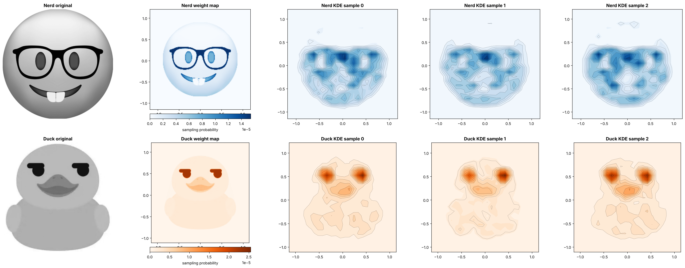
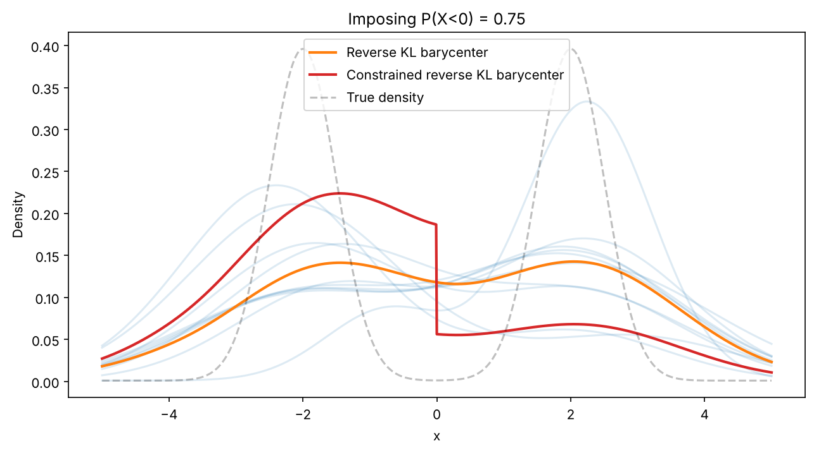
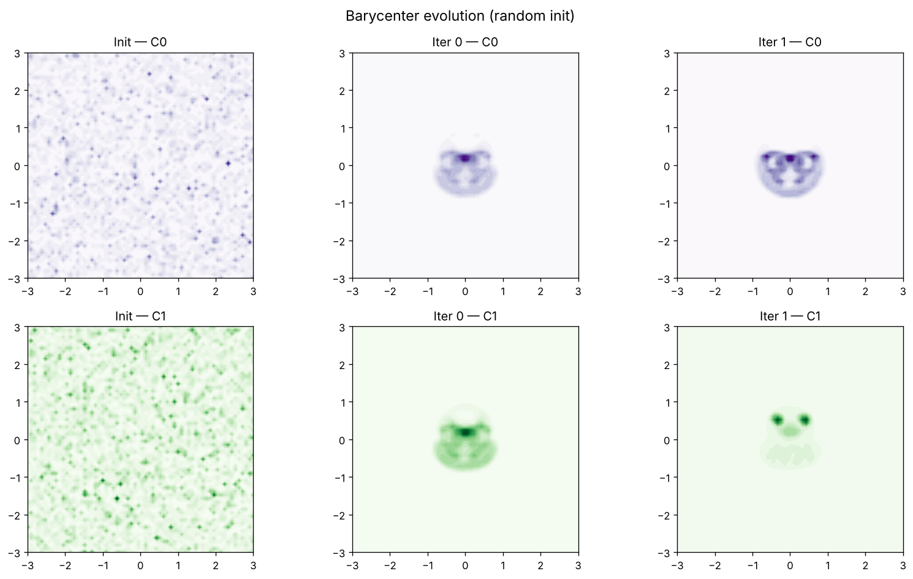

# K-Means Clustering for Estimated Densities via Reverse KL Barycenters

> University of Toronto Summer Research Program (UTSSRP), Department of Statistical Sciences, June 2026.
> Group project with Alexandra Zhou, Alina Zhang and Justin Wu, supervised by Prof. Sebastian Jaimungal and Elijah French.

📄 **Poster:** [poster/poster.pdf](poster/poster.pdf)

## Question

If several models each give us a probability distribution, how do we average them into one distribution? And can we use that average as the "center" of a cluster in order to cluster *distributions* rather than points?

## Approach

- **Reverse KL barycenter.** The average of $`P_1,\dots,P_n`$ is $`\arg\min_q \sum_i \mathrm{KL}(q\,\|\,P_i)`$. Its solution is the normalised geometric mean $`\propto \prod_i P_i^{1/n}`$.
- **Constraints.** Prior information such as $`P_q(X<x_0)=c`$ is added via Lagrange multipliers. The solution is an exponential tilt of the unconstrained barycenter, which for a two-region constraint just rescales the two regions. For general convex constraints the problem is solved numerically with `cvxpy`.
- **K-means for densities.** Lloyd's algorithm with KL divergence as the distance and the reverse KL barycenter as the cluster center.
- **Application.** Two emoji images (🤓 nerd, 🦆 duck) are treated as 2D distributions over pixels. We draw 20 noisy samples from each, fit a KDE to every sample, and check whether the algorithm separates the 40 densities.

## Key results

- **1D:** imposing $`P(X<0)=0.75`$ gives a closed-form exponential tilt with $`\mu^*\approx-1.199`$. A root-finding solver reproduces it to machine precision. The reverse KL barycenter has the smallest $`\sum_j\mathrm{KL}(q\,\|\,\mathrm{KDE}_j)`$ and the forward KL barycenter the smallest $`\sum_j\mathrm{KL}(\mathrm{KDE}_j\,\|\,q)`$, as theory predicts.
- **2D:** all 40 KDEs are clustered correctly (20 nerd / 20 duck), and the assignments stop changing after two updates. This holds even from a bad start (both initial centers are ducks), from random-noise centers, and when points are sampled uniformly instead of by pixel darkness.
- **Constraints in 2D:** the closed-form constrained update and the general `cvxpy` solver agree to within $`3\times10^{-9}`$ (largest cell $`\approx 10^{-2}`$), and adding constraints does not change the clustering.

| 1D: constrained barycenter | 2D: barycenters during K-means |
|---|---|
|  |  |

## Repository structure

    notebooks/
      1d_constrained_barycenter.ipynb   constrained barycenter in 1D, forward vs reverse KL, numerical checks
      2d_kmeans_nerd_vs_duck.ipynb      images -> KDEs -> K-means with (constrained) reverse KL barycenters
    data/       the two emoji images (found online; used for illustration only)
    figures/    figures written by the notebooks
    poster/     final research poster

## How to run

    pip install -r requirements.txt
    cd notebooks
    jupyter nbconvert --to notebook --execute --inplace 1d_constrained_barycenter.ipynb
    jupyter nbconvert --to notebook --execute --inplace 2d_kmeans_nerd_vs_duck.ipynb

All random seeds are fixed, so the outputs should match those stored in the notebooks. The 2D notebook takes under a minute.

## My role

The theory on the poster (barycenter theorems and proofs) was developed by the group with our supervisors. My parts were:

- **Constrained barycenters in 1D** (`1d_constrained_barycenter.ipynb`, Sections 3–6; poster Figure 3): adding the probability constraint $`P(X<0)=0.75`$, checking it numerically, comparing forward and reverse KL, and the two-Gaussian constraint experiments. Sections 1–2 of that notebook come from the group's shared notebook.
- **The 2D application** (`2d_kmeans_nerd_vs_duck.ipynb`; poster Figures 7–9), done on my own: turning images into weighted point clouds, the KDE pipeline, K-means with reverse KL barycenters, the robustness experiment, and constrained barycenters with both the closed form and `cvxpy`.

## Use of AI and changes after the program

The code for my parts of both notebooks (the 1D constraint work and the 2D application) was generated with AI assistance during the program; I directed the work, ran the experiments, and made sure I understood each step.

In November 2026, while preparing this repository, I reviewed the notebooks with an AI assistant (Claude). That review found inconsistencies in the original 2D notebook, which are corrected here:

- Some written explanations and one derivation described the **forward** KL barycenter (arithmetic mean), and the general `cvxpy` solver optimised the forward KL objective. The project is about the **reverse** KL barycenter, so all of these now use the geometric mean.
- The figure used for poster Figure 9 was produced by a version of the loop that used the arithmetic mean and always stopped after two iterations. The notebook now uses one K-means function throughout, with a correct stopping rule.
- The robustness experiment (uniform vs weighted sampling) is now generated by code instead of quoted numbers, and the notebooks were restructured to run outside Google Colab.

## Limitations

- Densities live on a fixed 64 × 64 grid, and a small floor is added to every cell so that KL is finite. Results depend somewhat on this floor and on the KDE bandwidth.
- Nerd vs duck is an easy, well-separated example. It shows that the method works; it does not test the method on hard cases.
- The `cvxpy` solver handles convex constraints only (for example, a variance bound is convex only once the mean is fixed).

## References

1. S. Jaimungal and S. M. Pesenti. *Kullback–Leibler barycentre of stochastic processes*, 2024.
2. B. Silverman. *Density Estimation for Statistics and Data Analysis*, 1986.
